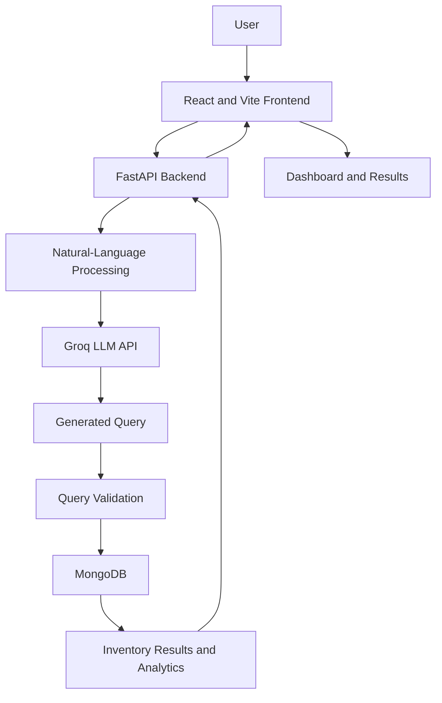

# StockPilot — LLM-Based Natural Language Query Generation for NoSQL Inventory Management

<p align="center">
  <strong>Query your inventory database using natural language.</strong>
</p>

<p align="center">
  An AI-powered inventory management application that converts natural-language questions into database queries and presents the results through an interactive dashboard.
</p>

<p align="center">
  
  
  
  
  
</p>

---

## 📌 Table of Contents

- [Overview](#-overview)
- [Problem Statement](#-problem-statement)
- [Objectives](#-objectives)
- [Key Features](#-key-features)
- [Technology Stack](#-technology-stack)
- [System Architecture](#-system-architecture)
- [Project Structure](#-project-structure)
- [Prerequisites](#-prerequisites)
- [Installation and Setup](#-installation-and-setup)
- [Running the Application](#-running-the-application)
- [Example Natural-Language Queries](#-example-natural-language-queries)
- [Security Considerations](#-security-considerations)
- [Testing](#-testing)
- [Limitations](#-limitations)
- [Future Enhancements](#-future-enhancements)
- [Contributing](#-contributing)
- [License](#-license)

---

## 🚀 Overview

**StockPilot** is an AI-assisted inventory management system designed to make database interaction easier for users who may not know SQL or MongoDB query syntax.

Users can enter questions in natural language. The application uses a Large Language Model (LLM) to help translate those questions into database queries, processes the request through a Python backend, and displays the results in a web-based interface.

The project combines natural-language processing, NoSQL database operations, backend API development, and interactive frontend visualizations.

## 🎯 Problem Statement

Traditional inventory management systems often require users to navigate multiple screens or understand predefined filters and database query structures to retrieve useful information.

Users without technical knowledge may find it difficult to ask questions such as:

- Which products have low stock?
- What is the current inventory value?
- Which categories contain the most products?
- Which products need restocking?

StockPilot aims to reduce this complexity by allowing users to interact with inventory data through natural-language questions.

## 🎯 Objectives

- Provide a natural-language interface for inventory queries.
- Use an LLM to assist with NoSQL query generation.
- Retrieve and process inventory information using MongoDB.
- Expose backend functionality through FastAPI endpoints.
- Present inventory information using a React-based dashboard.
- Support inventory analytics and useful business insights.
- Keep database access and AI credentials on the backend.

## ✨ Key Features

### 1. Natural-Language Querying
Enter questions in everyday language instead of manually writing database queries.

### 2. LLM-Assisted Query Generation
Use a configured Groq-hosted language model to interpret user questions and assist in generating database queries.

### 3. NoSQL Inventory Integration
Connect the backend to MongoDB to retrieve and process inventory records.

### 4. Interactive Web Interface
Use a React and Vite frontend to interact with the backend and display results.

### 5. Inventory Analytics
Present available inventory metrics and visualizations to help users understand stock levels and inventory performance.

### 6. Category and Product Insights
Organize inventory information by product and category to make analysis easier.

### 7. Backend API
Use FastAPI to provide an API layer between the frontend, AI query-generation logic, and MongoDB.

### 8. Modular Project Structure
Separate application code, scripts, datasets, reports, tests, and documentation for easier maintenance.

> Feature availability depends on the implementation and configuration in the current version of the project.

## 🛠️ Technology Stack

| Component | Technology |
|---|---|
| Programming language | Python |
| Backend framework | FastAPI |
| Frontend framework | React |
| Frontend tooling | Vite |
| Database | MongoDB |
| LLM integration | Groq API |
| API server | Uvicorn |
| Frontend linting | ESLint |
| Version control | Git and GitHub |

## 🏗️ System Architecture



### Architecture Explanation

1. **User Interface:** The user enters an inventory-related question in the React application.
2. **API Layer:** The frontend sends the request to the FastAPI backend.
3. **AI Processing:** The backend uses the configured LLM integration to interpret the question and assist with query generation.
4. **Query Validation:** The generated query should be validated against the application's permitted database operations.
5. **Database Access:** The backend executes the permitted operation against MongoDB.
6. **Response Processing:** The result is formatted and returned through the API.
7. **Visualization:** The frontend displays the response using the available tables, metrics, or charts.

## 📁 Project Structure

The repository is organized into application folders and supporting resources.

```text
LLM_NoSQL_Inventory_Management/
│
├── README.md
├── .gitignore
├── .env.example
├── requirements.txt
├── Dockerfile
├── docker-compose.yml
│
├── backend/
│   └── Application source code and API services
│
├── frontend/
│   └── React and Vite application
│
├── config/
│   └── Configuration resources
│
├── data/
│   └── Inventory data and related resources
│
├── datasets/
│   └── Benchmark datasets
│
├── docs/
│   └── Project documentation
│
├── notebooks/
│   └── Analysis and experimentation notebooks
│
├── scripts/
│   └── Utility, maintenance, and data scripts
│
├── reports/
│   └── Test reports and benchmark outputs
│
├── tests/
│   └── Test files
│
├── backups/
│   └── Local backup resources, if retained
│
├── logs/
│   └── Application logs, if enabled
│
└── vector_store/
    └── Local vector-store resources, if used
```

**Note:** Some folders may be empty or optional depending on your local configuration. The `.env` file contains local secrets and should not be committed to GitHub.

## 💻 Prerequisites

Install the following before running the application:

- Python compatible with the backend dependencies.
- Node.js and npm.
- MongoDB running locally or an accessible MongoDB deployment.
- A Groq API key if your configured LLM integration requires it.
- Git for source-code management.

Check your installed versions:

```powershell
python --version
node --version
npm --version
git --version
```

## ⚙️ Installation and Setup

### Step 1: Clone the repository

```powershell
git clone https://github.com/SuhasSC/StockPilot.git
cd StockPilot
```

### Step 2: Create and activate a Python virtual environment

On Windows PowerShell:

```powershell
python -m venv .venv
.\.venv\Scripts\Activate.ps1
```

If PowerShell blocks activation, consult the Python documentation for virtual-environment activation options appropriate to your system.

### Step 3: Install Python dependencies

```powershell
python -m pip install --upgrade pip
pip install -r requirements.txt
```

If your project uses a separate backend requirements file instead, install the dependencies from that file.

### Step 4: Configure environment variables

Create your local `.env` file using `.env.example` as a reference.

```powershell
Copy-Item .env.example .env
```

Open `.env` and fill in the actual values required by the application. For example, the configuration may include:

```env
MONGODB_URI=mongodb://127.0.0.1:27017
DATABASE_NAME=LLM_DB
GROQ_API_KEY=your_groq_api_key
```

**Important:** These names are examples. Check the backend configuration to confirm the exact environment-variable names expected by your implementation. Never commit your real API key or `.env` file.

### Step 5: Start MongoDB

Ensure MongoDB is running and accessible at the connection URI configured in your environment.

The example configuration uses:

```text
mongodb://127.0.0.1:27017
```

The database name in the example is `LLM_DB`. Change these values if your local setup uses different settings.

### Step 6: Install frontend dependencies

```powershell
cd frontend
npm install
cd ..
```

## ▶️ Running the Application

### Start the Backend

From the project root, activate the virtual environment and run:

```powershell
.\.venv\Scripts\python.exe -m uvicorn app.main:app --app-dir backend --reload
```

The backend should be available at:

- API base: `http://127.0.0.1:8000`
- Interactive API documentation: `http://127.0.0.1:8000/docs`

These addresses assume the backend starts successfully with the supplied configuration.

### Start the Frontend

Open a second terminal:

```powershell
cd frontend
npm run dev
```

Open the local URL printed by Vite, typically:

```text
http://localhost:5173
```

Keep the backend, frontend, and MongoDB services running while testing the application.

## 💬 Example Natural-Language Queries

The following are illustrative examples of questions a user might ask, depending on the supported query-generation logic and available inventory fields:

- "Show all products in the inventory."
- "Find products with low stock."
- "List products in a particular category."
- "Show products whose price is above a specified amount."
- "Count the products in each category."
- "Find products that may need restocking."

Actual query support depends on the database schema, prompt design, validation rules, and implemented API endpoints.

## 🔐 Security Considerations

- Store API keys and credentials in environment variables.
- Never commit `.env` or other files containing secrets.
- Use `.env.example` to document required configuration without including real credentials.
- Validate LLM-generated queries before execution.
- Restrict database operations to the minimum permissions required by the application.
- Avoid exposing database credentials or sensitive records in API responses and logs.
- Configure appropriate authentication and authorization before exposing the application publicly.
- Use HTTPS and secure production configuration when deploying the application.

An LLM-generated query should not automatically be considered safe. Validation and server-side access controls are important.

## 🧪 Testing

### Frontend linting

From the frontend directory:

```powershell
npm run lint
```

### Frontend production build

```powershell
npm run build
```

### Python syntax check

From the project root:

```powershell
.\.venv\Scripts\python.exe -m compileall -q backend
```

### Automated tests

If the project's Python tests are configured for pytest:

```powershell
python -m pytest
```

Run only the test commands supported by your installed dependencies and project configuration. A successful syntax check does not guarantee that database integration or all application features work correctly.

## ⚠️ Limitations

- Query quality depends on the configured LLM and the clarity of the user's question.
- Database results depend on the available inventory records and schema.
- LLM API availability, rate limits, and network connectivity can affect query generation.
- Generated queries require validation to prevent unintended database operations.
- Local development settings are not a substitute for production security and deployment configuration.
- Analytics accuracy depends on the completeness and quality of inventory data.

## 🔮 Future Enhancements

Possible future improvements include:

- Stronger validation and safer execution of generated NoSQL queries.
- Improved handling of ambiguous and multilingual questions.
- Authentication and role-based access control.
- Inventory forecasting and demand prediction.
- Low-stock alerts and restocking recommendations.
- Improved analytics and downloadable reports.
- Automated integration tests for the API and database.
- Production deployment with monitoring, logging, and secure secret management.

These are potential enhancements and should not be interpreted as features already implemented.

## 🤝 Contributing

Contributions and suggestions are welcome.

1. Fork the repository.
2. Create a feature branch.
3. Make your changes.
4. Run the applicable tests and lint checks.
5. Submit a pull request with a clear description of your changes.

## 📄 License

No license has been specified in this repository's README. Add an appropriate license file and update this section before distributing the project for reuse.

---

<p align="center">
  <strong>StockPilot</strong><br />
  Making inventory data easier to explore through natural language.
</p>
